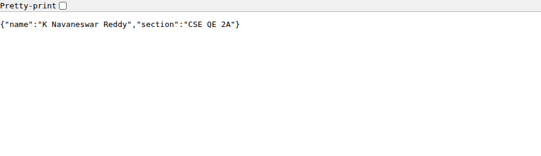
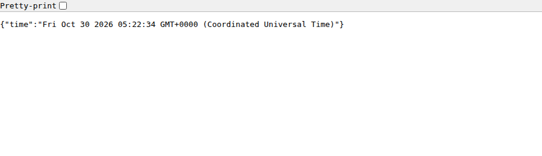

# Lab 1: Node.js and Express server

**Name:** K Navaneswar Reddy · **Roll number:** 252U1R8041 · **Section:** CSE QE 2A

**Live link:** Not deployed yet. Add the public URL here after deploying on Render, Railway or the NxtWave Cloud IDE.
(If it cannot be deployed, explain why here and add Postman screenshots of every endpoint.)

## How to run

Requires Node.js 18 or newer.

```bash
cd lab-01
npm install          # installs express into node_modules
npm start            # Express server on http://localhost:3000
npm run plain        # optional: plain http-module server on port 3000
```

Environment variables: `PORT` (optional, defaults to `3000`). No other variables or secrets are needed.

## Live Deployment

**Live Application:** https://lab-01-node-express.onrender.com/

**GitHub Repository:** https://github.com/navaneshreddy/lab-01-node-express

### Live API Endpoints

| Endpoint | Description |
|---|---|
| [Home](https://lab-01-node-express.onrender.com/) | Welcome message |
| [About](https://lab-01-node-express.onrender.com/about) | About information |
| [Time](https://lab-01-node-express.onrender.com/time) | Current date and time |
| [404 Test](https://lab-01-node-express.onrender.com/unknown) | Error handling |

## Endpoints

| Method | Path     | Description                                   | Status |
| ------ | -------- | --------------------------------------------- | ------ |
| GET    | `/`      | Welcome text                                  | 200    |
| GET    | `/about` | JSON with name and section                    | 200    |
| GET    | `/time`  | Current date and time (`new Date()`)          | 200    |
| ANY    | others   | Plain-text 404 message for unknown paths      | 404    |

## Files

- `plain-server.js`: Task 3, server using the built-in `http.createServer`, replies "Hello".
- `server.js`: Tasks 4-7, the same server rewritten with Express, with the three routes, the 404 handler and a status-code logger.
- `package.json`: project metadata (see the package.json fields below).

## package.json fields

- `name`, `version`, `description`: identify the project.
- `main`: entry point file (`server.js`).
- `scripts`: shortcuts run with `npm run <name>` (`npm start` runs `node server.js`).
- `keywords`, `author`, `license`: metadata for searching and credit.
- `dependencies`: packages the app needs at runtime (`express`); `npm install` reads this list.

## Status codes logged in the browser

| Route      | Status code    |
| ---------- | -------------- |
| `/`        | 200 OK         |
| `/about`   | 200 OK         |
| `/time`    | 200 OK         |
| `/unknown` | 404 Not Found  |

Server console output:

```
Express server running on http://localhost:3000
GET / -> 200
GET /about -> 200
GET /time -> 200
GET /unknown -> 404
```

## Screenshots






## Notes: problems faced and how you solved them

- The 404 handler must be registered after all routes, otherwise it would catch every request first.
- Added `process.env.PORT || 3000` so the same code works locally and on hosting platforms.
- `node_modules` and `.env` are listed in `.gitignore` and are not committed.

## Viva answers

- **package.json vs node_modules:** `package.json` is the small file that describes the project and lists its dependencies; `node_modules` is the folder where the actual downloaded package code lives. It can be recreated with `npm install`, so it is not committed.
- **What `app.listen` does:** it starts the HTTP server, binds it to a port and begins accepting requests; the callback runs once the server is ready.
- **Request and response:** `req` represents the incoming HTTP request (method, URL, headers, params, body); `res` is the object used to build and send the reply (status code, headers, body).
